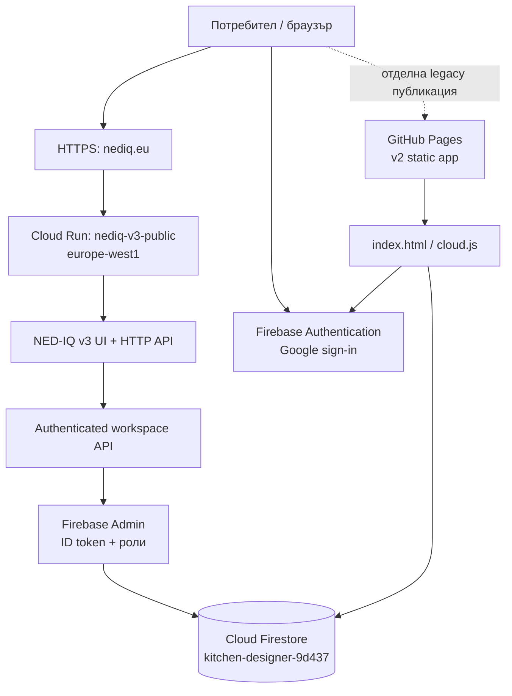
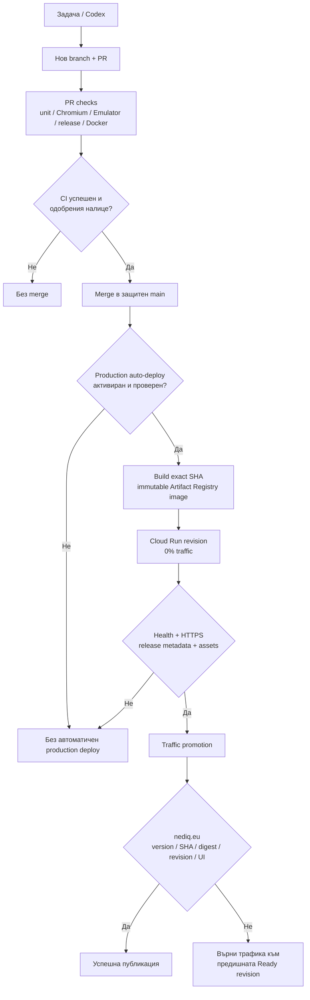

# NED-IQ — архитектура на приложението

> Жив технически обзор. Източници: кодът в `main`, [PROJECT_CONTEXT.md](../PROJECT_CONTEXT.md), [AGENTS.md](../AGENTS.md) и специализираните документи в `docs/`. При противоречие проверявай реалния код и deployment, а не историческо описание. **Не използвай този файл като доказателство за текущ production статус.**

## 1. Общ изглед

**Граница на доверие:** браузърът не избира произволно owner/actor за v3 запис. Сървърният API проверява Firebase ID token и права и извършва транзакционните операции. Firestore Rules остават отделна защита за клиентския достъп. Не приравнявай администраторския сървърен достъп с клиентските права.

## 2. Приложни слоеве

| Слой | Основни компоненти | Отговорност |
| --- | --- | --- |
| Legacy UI / v2 | `index.html`, `cloud.js`, `geometry.mjs`, `project-*.mjs`, `library-dialog.mjs` | 2D/3D редактор, два режима „Конструктор“/„Проект“, облачни проекти и модели |
| Геометрия и производство | `cabinet-generator*.mjs`, `grain.mjs`, `edge-editor.mjs`, `material-textures.mjs` | Размери, детайли, материали, кантове, физическа ориентация за разкрой и Salex |
| v3 документен модел | `document-format/`, `workspace-context/` | Единна схема на документ, активна сцена, Undo/Redo, съвместимост с legacy данни |
| v3 интеграция | `workspace-ui/`, `workspace-persistence/`, `release-candidate/` | Свързване на редактора, UI, профил, папки, роли, сървърна валидация и запис |
| v3 HTTP/API | `release-candidate/client.mjs`, `http.mjs`, `service.mjs` | Клиентски заявки, удостоверяване, проверки на права и транзакционен Firestore запис |
| Публикуване | `.github/workflows/`, `scripts/`, `Dockerfile` | CI, неизменяем Docker image, Cloud Run revisions, smoke проверки, rollback |

Имената на директориите и модулите са ориентир за навигация. За точния runtime entrypoint и dependency graph сверявай текущия `Dockerfile`, `package.json` и импортиращите модули.

## 3. Данни, права и съвместимост

- **Legacy v2:** `users/{uid}/v2_cabinets`, `users/{uid}/v2_projects`, `users/{uid}/materials` и съществуващите настройки, папки, чернови и споделяния. `cloud.js` и събитията `kitchen-v2-*` са договор за съвместимост.
- **v3:** `workspace_v3/{ownerUid}` съдържа документи, папки, настройки, права и журнал на операции; точните вложени пътища се определят от `release-candidate/service.mjs` и Firestore правилата. Не допускай директни клиентски записи, които заобикалят сървърната транзакция.
- **Права:** собственик, редактор и наблюдател; наблюдателят не записва. Проверявай owner/actor, ревизия, права и конфликт при всяка операция.
- **Съвместимост:** пази идентификатори, групи, размери, материали, кантове, ориентация, снимки, история и чернови. Миграция се изпълнява само след архив, dry-run и изрично одобрение. Тестовете използват емулатори или синтетични копия, не реални потребителски записи.

## 4. CI/CD и production

Това е **целевият процес**, разработван в [Draft PR #142](https://github.com/nedkoradev/kitchen-calculator/pull/142), а не твърдение, че автоматичният production режим вече е активен. Докато `NEDIQ_V3_AUTO_DEPLOY` не е изрично активиран след реална проверка, merge в `main` не трябва да се приема за автоматично публикуване на v3.

- Google Cloud project: `kitchen-designer-9d437`; Cloud Run service: `nediq-v3-public`; region: `europe-west1`.
- Съществуващите GitHub Actions, Workload Identity Federation, Artifact Registry и Cloud Run се преизползват; не създавай паралелна инфраструктура.
- Нова ревизия се проверява с 0% production трафик преди promotion. При провал след promotion се възстановява записаната предишна Ready ревизия; rollback на трафика **не** възстановява Firestore данни.
- Не променяй DNS, Firestore Rules, secrets, service accounts или production данни като страничен ефект от документация или обикновен UI release.
- `release.json` на v3 трябва да идентифицира версия, commit SHA, image digest, Cloud Run revision, време и тестово изпълнение. Сверявай го с видимата UI версия. Legacy v2 `release.json` е отделен Jekyll механизъм.
- **Версиониране:** v3 използва `release-candidate/release.mjs` и строго растяща v3 версия при runtime промени; legacy v2 използва `_data/version.json`. Не увеличавай v2 само заради v3-only промени. Следвай актуалните проверки от PR #142, когато бъдат слети.

## 5. Оперативни проверки и източници

1. Преди работа: прочети `AGENTS.md`, `PROJECT_CONTEXT.md` и този файл; провери `main`, PR-ите, реалната версия и публикувания commit.
2. Преди merge: провери GitHub PR checks за точния head SHA; не използвай admin bypass.
3. Преди production activation: провери WIF за `push`, минимални IAM права, production-probe, реален rollback и задължителна branch protection.
4. След production: сравни HTTPS, HTML/UI, JS/CSS, `release.json`, commit, digest, revision и отказ на неоторизиран API достъп.
5. При архитектурна промяна актуализирай **този файл и `PROJECT_CONTEXT.md` в същия PR**.

### Подробни документи

- [Единен формат на документите](UNIFIED-DOCUMENT-FORMAT.md)
- [Единен работен контекст](UNIFIED-WORKSPACE.md)
- [Интеграция на редактора](WORKSPACE-INTEGRATION.md)
- [Тестов запис и чернови](WORKSPACE-TEST-PERSISTENCE.md)
- [Реална интеграция на редактора](WORKSPACE-REAL-INTEGRATION.md)
- [Кандидат v3](NEDIQ-3-RELEASE.md)
- [Публичен Cloud Run cutover](NEDIQ-3-PUBLIC-CUTOVER.md)
- [Автоматизация на production deployment — Draft PR #142](https://github.com/nedkoradev/kitchen-calculator/pull/142)
